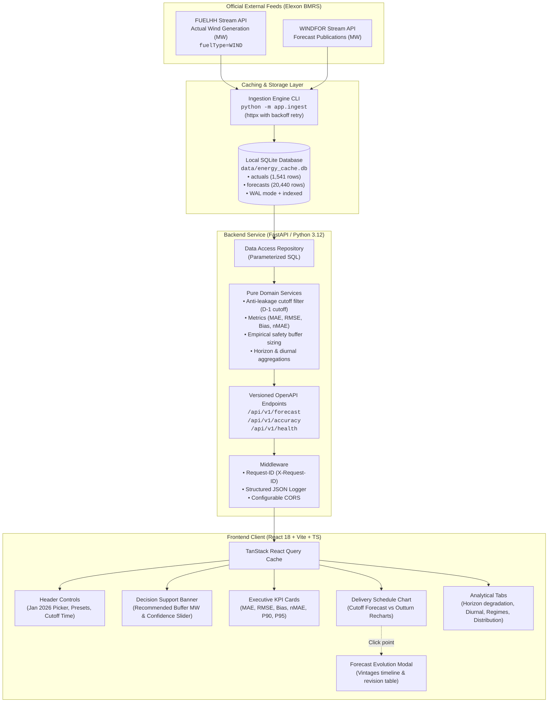

# UK Wind Day-Ahead Procurement Desk | Decision Support Platform

[](https://github.com/JAXSH3/gridbrick-assignment-/actions)
[](https://www.python.org/downloads/)
[](https://react.dev/)
[](https://fastapi.tiangolo.com/)
[](https://opensource.org/licenses/MIT)

> **Live Deployment Demo**: [https://uk-wind-procurement-demo.vercel.app](https://uk-wind-procurement-demo.vercel.app) *(Placeholder)*  
> **Backend API Docs**: [https://uk-wind-backend.onrender.com/api/v1/docs](https://uk-wind-backend.onrender.com/api/v1/docs) *(Placeholder)*  
> **Video Walkthroughs**: [5-Min Customer Pitch](docs/demo_customer_pitch.md) | [5-Min Technical Walkthrough](docs/demo_technical_walkthrough.md)

---

## 1. Project Overview

A UK electricity utility's day-ahead power buying desk must procure wholesale power one day before delivery ($D-1$) to balance customer electricity demand, net of weather-dependent wind generation. If the utility relies on inaccurate wind forecasts, unexpected generation deficits leave the desk exposed to severe cashout penalties in the real-time balancing mechanism.

This platform empowers power traders and risk managers to:
1. **Reconstruct the exact wind forecast** that was published and available at the day-ahead gate closure cutoff (default 09:00 UTC on $D-1$), with an absolute guarantee of **no look-ahead leakage**.
2. **Quantitatively evaluate forecast accuracy** (MAE, RMSE, Bias, nMAE, $P_{90}$, $P_{95}$) against official Elexon BMRS actuals across **January 2026**.
3. **Calculate and size a statistical safety buffer (in MW)** at customizable confidence intervals (80%–99%) to protect trading margins against costly deficit events.
4. **Inspect forecast evolution across successive vintages** for any half-hour delivery slot over the 48 hours leading up to delivery.
5. **Explore analytical deep-dives**: lead-time horizon error degradation (0–48h), diurnal 24h bias, and wind generation regimes (Low, Medium, High).

---

## 2. System Architecture



---

## 3. Directory & File Structure

```text
├── backend/                        # FastAPI Python 3.12 backend
│   ├── app/
│   │   ├── main.py                 # Application factory, lifespan, CORS, middleware
│   │   ├── ingest.py               # CLI command (python -m app.ingest)
│   │   ├── core/
│   │   │   ├── config.py           # Settings, environment overrides, cutoff defaults
│   │   │   └── logging.py          # Structured JSON logging & X-Request-ID middleware
│   │   ├── db/
│   │   │   ├── session.py          # SQLite connection manager, WAL mode, schemas
│   │   │   └── repository.py       # Fast indexed queries for actuals & forecast vintages
│   │   ├── services/
│   │   │   ├── ingestion.py        # Chunked stream fetcher, retry logic, data profiling
│   │   │   └── domain.py           # Pure domain logic: cutoff selection, metrics, buffer
│   │   ├── schemas/                # Pydantic v2 request/response models
│   │   │   ├── forecast.py         # Delivery slots and vintage schemas
│   │   │   ├── accuracy.py         # Summary, horizon, diurnal, regimes, buffer schemas
│   │   │   └── health.py           # Health and diagnostic schemas
│   │   └── api/v1/                 # Versioned REST API routes
│   │       ├── router.py           # Master v1 router aggregating endpoints
│   │       ├── health.py           # GET /api/v1/health
│   │       ├── forecast.py         # GET /api/v1/forecast/latest, /vintages
│   │       └── accuracy.py         # GET /api/v1/accuracy/summary, /by-horizon, /buffer...
│   ├── tests/                      # Pytest test suite (100% network-mocked / pure)
│   │   ├── test_cutoff.py          # Cutoff boundary, anti-leakage, and date math tests
│   │   ├── test_domain_metrics.py  # Hand-computed reference validation (MAE, RMSE, Bias, nMAE)
│   │   ├── test_buffer.py          # Empirical shortfall quantile & buffer sizing tests
│   │   ├── test_aggregations.py    # Horizon, diurnal, and regime aggregation tests
│   │   ├── test_health.py          # Basic health check tests
│   │   └── test_api.py             # TestClient integration tests across all v1 routes
│   ├── pyproject.toml              # Ruff, Mypy, and Pytest configuration
│   └── Dockerfile                  # Python 3.12-slim container with healthcheck
├── frontend/                       # React 18 + TypeScript + Vite frontend
│   ├── src/
│   │   ├── App.tsx                 # Main dashboard layout and query integration
│   │   ├── main.tsx                # Mount point with TanStack Query Provider
│   │   ├── index.css               # UK Energy Trading Desk bespoke CSS design system
│   │   ├── types/api.ts            # TypeScript interfaces matching backend models
│   │   ├── api/client.ts           # Type-safe API client functions
│   │   ├── components/
│   │   │   ├── Header.tsx          # Date picker (Jan 2026), presets, cutoff selector
│   │   │   ├── DecisionBanner.tsx  # Hero card with recommended MW buffer & slider
│   │   │   ├── MetricCards.tsx     # MAE, RMSE, Bias, nMAE, P90, P95 KPI cards
│   │   │   ├── ForecastChart.tsx   # Recharts delivery schedule (forecast vs actual)
│   │   │   ├── VintageModal.tsx    # Modal tracking forecast evolution across vintages
│   │   │   └── AccuracyTabs.tsx    # 4 deep-dive tabs (horizon, diurnal, regimes, dist)
│   │   └── test/                   # Vitest unit tests
│   │       ├── Header.test.tsx
│   │       ├── MetricCards.test.tsx
│   │       ├── DecisionBanner.test.tsx
│   │       └── App.test.tsx
│   ├── nginx.conf                  # Production Nginx reverse-proxy & SPA routing
│   ├── package.json
│   ├── tsconfig.json
│   ├── vite.config.ts
│   └── Dockerfile                  # Multi-stage build (Node 20 -> Nginx alpine)
├── data/
│   └── energy_cache.db             # Committed seed cache (1,541 actuals, 20,440 forecasts)
├── docs/
│   ├── architecture.md             # Detailed architecture and sequence diagrams
│   ├── decisions.md                # Mathematical formulations and domain assumptions
│   ├── demo_customer_pitch.md      # 5-min customer pitch script with presenter cues
│   └── demo_technical_walkthrough.md# 5-min technical walkthrough script
├── .github/workflows/ci.yml        # CI pipeline: lint, typecheck, pytest, vitest, docker
├── docker-compose.yml              # Local multi-service orchestration
├── render.yaml                     # One-click Render deployment blueprint
└── README.md                       # Master documentation
```

---

## 4. How to Run Locally

### Option A: Using Docker Compose (Recommended)

Make sure Docker and Docker Compose are installed and running:

```bash
# Clone the repository
git clone https://github.com/JAXSH3/gridbrick-assignment-.git
cd gridbrick-assignment-

# Launch both backend and frontend services
docker compose up --build
```

- **Frontend Dashboard**: Open [http://localhost:3000](http://localhost:3000)
- **Backend API Docs (Swagger)**: Open [http://localhost:8000/api/v1/docs](http://localhost:8000/api/v1/docs)
- **Health Check**: Open [http://localhost:8000/health](http://localhost:8000/health)

---

### Option B: Without Docker (Local Development)

#### 1. Backend Setup (Python 3.11 / 3.12)
```bash
cd backend

# Create and activate virtual environment (optional)
python -m venv .venv
source .venv/bin/activate  # On Windows: .venv\Scripts\activate

# Install dependencies
pip install -e ".[dev]"

# (Optional) Re-ingest data from Elexon BMRS
python -m app.ingest

# Start backend server on port 8000
uvicorn app.main:app --host 127.0.0.1 --port 8000 --reload
```

#### 2. Frontend Setup (Node.js 20+)
```bash
cd frontend

# Install npm packages
npm install

# Start Vite dev server on port 3000
npm run dev
```
Open [http://localhost:3000](http://localhost:3000) in your browser.

---

## 5. Running Tests & Quality Verification

### Backend Tests, Linting & Type-Checking
```bash
cd backend

# Run the complete Pytest suite (26 passing tests)
pytest -v

# Run Ruff linter and formatter check
ruff check .
ruff format --check .

# Run static type checking with Mypy
mypy app
```

### Frontend Unit Tests & Build
```bash
cd frontend

# Run Vitest unit tests (4 test files, 7 passing tests)
npm test

# Build production bundle
npm run build
```

---

## 6. How to Re-Ingest Data from Elexon BMRS

The database comes pre-seeded in `data/energy_cache.db`. To refresh or re-ingest directly from the Elexon BMRS stream endpoints:

```bash
cd backend
python -m app.ingest --force
```

This will:
1. Stream all half-hourly actuals from `https://data.elexon.co.uk/bmrs/api/v1/datasets/FUELHH/stream?fuelType=WIND` in 7-day chunks.
2. Stream all forecast vintages from `https://data.elexon.co.uk/bmrs/api/v1/datasets/WINDFOR/stream` in 7-day chunks.
3. Automatically compute the lead-time horizon in hours: `(startTime - publishTime)`.
4. Run an automated data quality profiler and print an audit report.

---

## 7. Design Decisions & Assumptions

| Domain Aspect | Decision / Assumption | Rationale |
| :--- | :--- | :--- |
| **Decision Cutoff** | Default `09:00 UTC` on $D-1$ before delivery day $D$. | Replicates UK day-ahead wholesale gate closure. Configurable via env var and UI selector. |
| **Anti-Leakage Rule** | Filter $\text{publishTime} \le \text{cutoff}(D-1)$. Select $\max(\text{publishTime})$. | Boundary $\text{publishTime} == \text{cutoff}$ is included. Any publication *after* cutoff is strictly excluded to prevent look-ahead leakage. |
| **Timezone** | Strictly UTC (ISO-8601). | UK operates on GMT (UTC+0) throughout January 2026. Avoids daylight saving ambiguity. |
| **Resolution Differences** | Actuals are 30-min (`:00`, `:30`); forecasts are hourly (`:00:00Z`). | Metric evaluations are computed on the 744 hourly slots where actuals and forecasts coexist, preserving original Elexon data fidelity. |
| **Normalized MAE** | $\text{nMAE} = \frac{\text{MAE}}{\text{Mean}(A)} \times 100\%$ | Traditional MAPE ($\frac{\|F-A\|}{A}$) explodes during low-wind calm periods. nMAE is the grid industry standard. |
| **Safety Buffer Sizing** | $B_C = \text{Quantile}_C(\{ \max(0, F_i - A_i) \})$ | Empirically sizes the procurement buffer in MW so that shortfalls exceed $B_C$ in no more than $(1 - C)$ of settlement periods. |

*For complete mathematical proofs and details, see [docs/decisions.md](docs/decisions.md).*

---

## 8. Deployment Guide

### Deploy Backend to Render
1. Fork or push this repository to GitHub.
2. Sign in to [Render](https://render.com) and click **New > Blueprint**.
3. Select your repository. Render automatically reads [render.yaml](render.yaml) and deploys `uk-wind-procurement-backend` as a Docker web service.
4. Note your public backend URL (e.g. `https://uk-wind-backend.onrender.com`).

### Deploy Frontend to Vercel
1. Sign in to [Vercel](https://vercel.com) and click **Add New > Project**.
2. Select the repository and set **Root Directory** to `frontend`.
3. Under **Environment Variables**, add:
   - `VITE_API_URL` = `https://uk-wind-backend.onrender.com` (your deployed backend URL).
4. Click **Deploy**. Vercel will build and serve the single-page application.

---

## 9. AI Tools Used

**Built with assistance from Google Antigravity (Gemini/Claude)**  
Antigravity was utilized for project scaffolding, research of Elexon BMRS endpoint parameters, test-driven development of pure domain functions, and creation of the visual design system.
