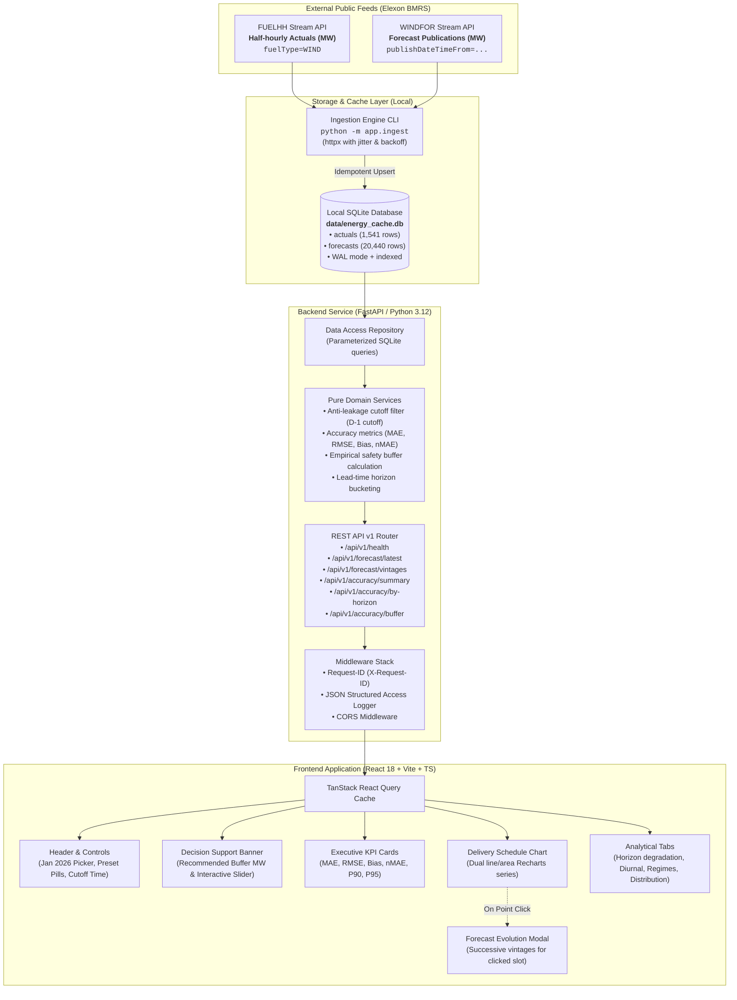
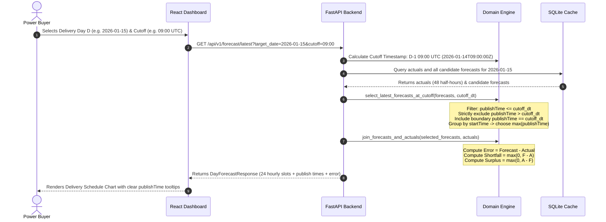
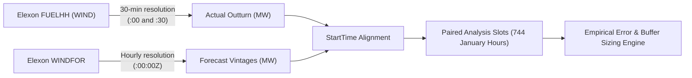

# System Architecture & Technical Specifications

## 1. High-Level System Architecture

The UK Wind Day-Ahead Procurement Desk is built as a high-performance, containerized full-stack platform designed to reconstruct exact day-ahead wind forecasts without look-ahead leakage, quantitatively evaluate forecast performance, and size statistical safety buffers for trading desks.

---

## 2. Decision Cutoff & Anti-Leakage Workflow

A central requirement of power procurement is **never using future data** when evaluating past decisions. For delivery day $D$, the day-ahead market order is finalized on day $D-1$ at cutoff time $T_{cutoff}$ (default `09:00 UTC`).

---

## 3. Data Flow & Granularity Mapping

